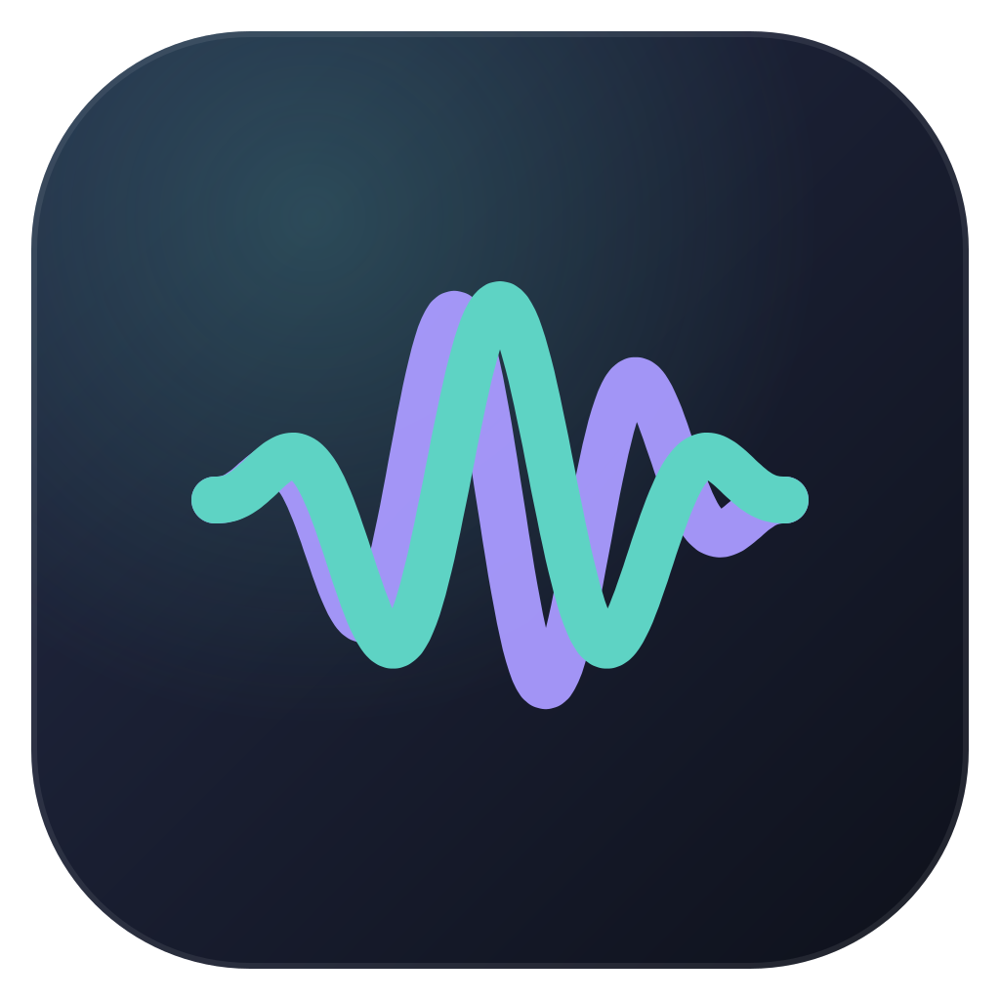

<p align="center">
  
</p>

<h1 align="center">MindHz</h1>

<p align="center">
  Свободная студия звуковых частот для Windows: бинауральные и монауральные биения, изохронные импульсы,
  амплитудная модуляция, шумы, конструктор сеансов и экспорт WAV/FLAC.<br>
  Свобода экспериментов — при честном представлении научных данных.
</p>

<p align="center">
  <a href="https://github.com/DS9-dev/MindHz/releases/latest"><b>Скачать для Windows</b></a> ·
  <a href="#для-разработчиков">Для разработчиков</a> ·
  <a href="docs/SCIENCE.md">Как мы оцениваем науку</a> ·
  <a href="#english">English</a>
</p>

---

## Что умеет MindHz

- **Генератор** — собирайте звук из слоёв (до 8): чистый тон, бинауральные и монауральные биения, изохронные импульсы, амплитудная модуляция, белый/розовый/коричневый шум. Все параметры меняются во время воспроизведения плавно, без щелчков.
- **Каталог частот** — ритмы мозга (дельта–гамма), акустика и строй (440, 432, 256 Гц…), частоты сольфеджио, резонанс Шумана, шумы и ваши собственные частоты. Для каждой записи — назначение, научная интерпретация со ссылками на проверяемые публикации, уровень доказательности, ограничения и (отдельно, с пометкой) эзотерическая трактовка.
- **Режимы** — 17 готовых программ: концентрация, чтение, обучение, расслабление, медитация, подготовка ко сну, сольфеджио и другие. Каждая объясняет своё назначение и степень научной обоснованности.
- **Конструктор сеансов** — многоэтапные программы с плавными или мгновенными переходами, несколькими слоями, изменением интенсивности и графиком частот.
- **Проигрыватель** — работает в любом разделе: таймер сна, непрерывное прослушивание, визуализация волны, ритма и спектра, индикаторы уровня, медиаклавиши.
- **Экспорт** — WAV (16/24/32 бит) и FLAC (16/24 бит), 44,1/48/96 кГц, стерео или моно. Файл совпадает с тем, что звучит в проигрывателе: используется тот же аудиодвижок.
- **Безопасность** — суммарный уровень слоёв ограничен (клиппинг невозможен), громкость никогда не повышается сама, есть предел громкости, плавные нарастания и предупреждения.
- Работает **полностью офлайн**, без регистрации и без сбора данных. Русский и английский интерфейс, тёмная и светлая темы, эффект Mica в Windows 11.

> **MindHz не является медицинским изделием** и не обещает лечения, повышения интеллекта или духовного пробуждения. Названия режимов описывают предполагаемое применение, а не гарантированный результат.

## Установка

1. Откройте страницу [последнего релиза](https://github.com/DS9-dev/MindHz/releases/latest).
2. Скачайте один из файлов:
   - **`MindHz-Setup-<версия>.exe`** — обычный установщик. Создаёт ярлыки на рабочем столе и в меню «Пуск», удаляется через «Параметры → Приложения». Права администратора не нужны.
   - **`MindHz-Portable-<версия>.zip`** — портативная версия. Распакуйте архив в любую папку (например, на флешку) и запустите `MindHz.exe`.
3. Ничего дополнительно устанавливать не нужно: всё необходимое уже внутри.

### Предупреждение Windows SmartScreen

MindHz пока распространяется без платной цифровой подписи, поэтому при первом запуске Windows может показать окно «Система Windows защитила ваш компьютер». Это обычное поведение для новых неподписанных программ.

- Нажмите **«Подробнее» → «Выполнить в любом случае»**, если скачали файл со страницы релизов этого репозитория.
- Чтобы убедиться, что файл не изменён, сравните его контрольную сумму с файлом `SHA256SUMS.txt` из релиза. В PowerShell:
  ```powershell
  Get-FileHash .\MindHz-Setup-0.1.0.exe -Algorithm SHA256
  ```

### Где хранятся настройки

| Версия | Папка данных |
|---|---|
| Установленная | `%APPDATA%\MindHz` — сохраняется при обновлении и при удалении программы |
| Портативная | папка `MindHz-Data` рядом с `MindHz.exe`. Если туда нельзя писать (например, внутри `Program Files`), используется `%APPDATA%\MindHz`, и программа сообщит об этом |

Папку данных можно открыть из **Настройки → Данные → Папка данных**. Пресеты можно экспортировать в файл `.json` и импортировать на другом компьютере.

### Обновление

Скачайте новую версию со страницы релизов и установите поверх старой — настройки и пресеты сохранятся. Для портативной версии перенесите папку `MindHz-Data` в новую распакованную папку. MindHz не скачивает обновления сам (см. [docs/UPDATES.md](docs/UPDATES.md)).

### Удаление

«Параметры Windows → Приложения → MindHz → Удалить». Ваши пресеты остаются в `%APPDATA%\MindHz` — удалите эту папку вручную, если они больше не нужны (или воспользуйтесь **Настройки → Удалить все данные** до удаления программы).

## Как слушать безопасно

- Начинайте с тихой громкости. Ни одна частота не безопасна при любой громкости.
- Бинауральные биения требуют наушников; остальные режимы работают и через колонки.
- При неприятных ощущениях, головной боли или тревоге прекратите прослушивание.
- Не используйте режимы расслабления и сна за рулём. При эпилепсии, психических или сердечных заболеваниях посоветуйтесь с врачом.

## Научная честность

В MindHz различаются три разные «частоты»:

- **слышимая частота** — высота тона, который вы слышите;
- **частота ритма** — скорость биений, импульсов или модуляции этого тона;
- **диапазон ЭЭГ** — диапазон электрической активности мозга, с которым связывают определённые состояния.

Совпадение ритма звука с диапазоном ЭЭГ **не означает**, что мозг перейдёт в соответствующее состояние; регистрируемая реакция мозга на звук **не равна** улучшению функций. Каждое утверждение отнесено к одному из уровней: установленный факт, подтверждено исследованиями, предварительные данные, недостаточно изучено, эзотерическое представление. Источники — только реальные публикации; где их нет, это сказано прямо. Подробнее: [docs/SCIENCE.md](docs/SCIENCE.md).

---

## Для разработчиков

### Стек

- **Electron 43** + **TypeScript**, интерфейс на **React 19** (собственная дизайн-система без UI-библиотек).
- Сборка — **esbuild**; упаковка — **electron-builder** (NSIS + портативный ZIP).
- Аудиодвижок — собственный детерминированный синтезатор на TypeScript (`src/shared/audio/engine.ts`). Один и тот же код работает в **AudioWorklet** (воспроизведение) и в **Web Worker** (экспорт), поэтому экспорт совпадает с воспроизведением.
- Кодеки WAV и FLAC (фиксированные предикторы, разбиение Райса, mid/side, MD5) написаны без нативных зависимостей.
- Тесты — встроенный в Node.js `node:test` через `tsx`.

### Требования

- Node.js 22 LTS и npm. Больше ничего: Python и компиляторы не нужны.

### Команды

```bash
npm ci                 # установить зафиксированные зависимости
npm run dev            # сборка с source maps и запуск Electron с DevTools
npm test               # автотесты: точность частот, стерео, клиппинг, переходы, экспорт = воспроизведение, FLAC, хранение настроек
npm run typecheck      # проверка типов
npm run build          # production-сборка в dist/
npm run pack:win       # распакованная Windows-сборка в release/win-unpacked
npm run dist:win       # установщик NSIS + портативный ZIP в release/
npm run checksums      # SHA256SUMS.txt для файлов в release/
npm run smoke -- --exe release/win-unpacked/MindHz.exe   # сквозной тест собранного приложения
```

`npm run smoke` дважды запускает настоящее приложение в режиме самопроверки: движок в AudioWorklet (побитовое сравнение с эталоном), воспроизведение в реальном времени, экспорт WAV и FLAC через рабочий конвейер, сохранение и восстановление настроек после перезапуска; затем декодирует созданные файлы.

### Структура

```
src/shared/      модели данных, аудиодвижок, кодеки, каталог, пресеты, валидация (без DOM/Node API)
src/main/        главный процесс Electron: окно, безопасность, протокол app://, хранилище, запись файлов
src/preload/     узкий типизированный мост IPC
src/renderer/    интерфейс (React), AudioWorklet, worker экспорта, i18n
tests/           автотесты
scripts/         сборка, портативный ZIP, контрольные суммы, smoke-тест
docs/            наука, архитектура, релизы, обновления
```

Подробности — в [docs/ARCHITECTURE.md](docs/ARCHITECTURE.md).

### Безопасность Electron

Изолированный контекст, `sandbox`, без Node.js в интерфейсе, строгая CSP, собственный протокол `app://` с защитой от выхода за пределы каталога, запрет навигации и новых окон, проверка отправителя каждого IPC-вызова; интерфейс никогда не получает произвольные пути к файлам.

### Выпуск релиза

```bash
# 1. поднять версию в package.json и добавить раздел в CHANGELOG.md
# 2. закоммитить и отправить тег
git tag v0.1.1 && git push origin v0.1.1
```

GitHub Actions соберёт установщик и портативную версию, прогонит тесты и три smoke-теста (распакованная, портативная, установленная → удалённая версии) на чистой Windows-машине, посчитает SHA-256 и опубликует релиз. Подробно: [docs/RELEASING.md](docs/RELEASING.md).

### Лицензия

[MIT](LICENSE) © 2026 DS9-dev.

---

## English

**MindHz** is a free, offline frequency studio for Windows: binaural and monaural beats, isochronic pulses, amplitude modulation, white/pink/brown noise, a multi-stage session builder, a live player with visualisations and WAV/FLAC export that is sample-identical to playback. A frequency catalogue rates every claim by strength of evidence, cites only real publications and keeps esoteric interpretations visually separate.

**Install:** download `MindHz-Setup-<version>.exe` (installer) or `MindHz-Portable-<version>.zip` (unzip and run `MindHz.exe`) from [Releases](https://github.com/DS9-dev/MindHz/releases/latest). The app is not code-signed yet, so SmartScreen may warn on first launch: choose **More info → Run anyway**, and verify the file against `SHA256SUMS.txt`. Settings live in `%APPDATA%\MindHz` (installed) or `MindHz-Data` next to the exe (portable).

MindHz is not a medical device and makes no therapeutic or cognitive-enhancement claims. Listen at a low volume.

Developers: `npm ci && npm run dev`; see the section above for commands. The UI language can be switched to English in Settings (catalogue texts are Russian-only for now).
